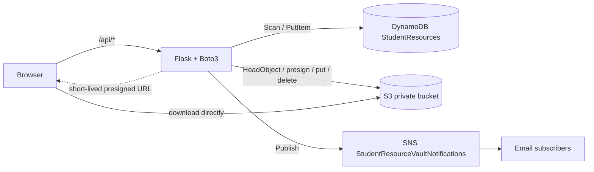

# Student Resource Cloud Vault

Flask app for browsing, searching and downloading academic resources. Files are in **Amazon S3** (private bucket), metadata in **Amazon DynamoDB**, and **Amazon SNS** announces newly added resources. All AWS calls run on the backend; the browser never receives credentials.

## Status: what is and is not verified
| Area | Status |
|---|---|
| Catalogue, search, filter, pagination, schema detection, S3 URI/URL parsing, presigned downloads, error mapping, uploads, upload validation, S3 cleanup, SNS publish/failure, token auth, demo vs live mode, templates/static routes, inspect script | **Mock-tested** (moto, 59 tests: `pytest -q`) |
| Server starts and degrades cleanly with no AWS access (waitress and Flask) | **Verified** on Linux |
| Your real table attributes, real S3 keys, role permissions, real SNS email delivery | **Not yet verified.** Run `python scripts/inspect_aws.py` with fresh lab credentials |
| Windows PowerShell run steps and `scripts/set-credentials.ps1` | **Not executed by the author** (no Windows/PowerShell available); written to standard PowerShell syntax |
| Hosted deployment | **Not done**, documented only |

## Architecture


How a record becomes a file (first match wins): an S3-key attribute (`S3Key`, `key`, `s3_uri`, ...) holding `s3://bucket/key`, an S3 https URL, or a plain key; else a filename attribute holding a path; else `Folder` + `FileName` -> `Folder/FileName`; else `S3_KEY_PREFIX` + `FileName`. The last two are conventions, not facts: the download endpoint always `HeadObject`s the key first and returns 404 if it does not exist. `inspect_aws.py` shows exactly which key each record resolves to. If the record names a different bucket than `S3_BUCKET`, the download is refused (409).

## Windows PowerShell: install and run
```powershell
cd student-resource-vault
python -m venv .venv
.\.venv\Scripts\Activate.ps1          # if blocked: Set-ExecutionPolicy -Scope Process Bypass
pip install -r requirements.txt
Copy-Item .env.example .env           # edit .env: set S3_BUCKET (non-secret settings only)

# Fresh AWS Academy credentials, in THIS SAME window (Flask failed earlier because they were set in another one):
$env:AWS_ACCESS_KEY_ID="..."; $env:AWS_SECRET_ACCESS_KEY="..."; $env:AWS_SESSION_TOKEN="..."; $env:AWS_REGION="us-east-1"
#   or copy the "AWS CLI" block from AWS Details, then run: .\scripts\set-credentials.ps1

python scripts/inspect_aws.py         # read-only; shows real schema, bucket keys, SNS subscription status
python app.py                         # http://127.0.0.1:5000   (or: python serve.py  -> port 8000, waitress)
```
Credentials expire with the lab session: re-set them and restart the app.

## Environment variables (names used by the code)
| Variable | Purpose | Default |
|---|---|---|
| `AWS_ACCESS_KEY_ID`, `AWS_SECRET_ACCESS_KEY`, `AWS_SESSION_TOKEN` | credentials, shell only, never in files | none |
| `AWS_REGION` | region | `us-east-1` |
| `DDB_TABLE` | table | `StudentResources` |
| `S3_BUCKET` | existing bucket (**required for downloads**) | none |
| `S3_KEY_PREFIX` | prefix for filename-only records and new uploads | empty |
| `SNS_TOPIC_NAME` / `SNS_TOPIC_ARN` | existing topic (ARN skips discovery) | `StudentResourceVaultNotifications` |
| `PRESIGN_SECONDS` | download link lifetime, 30-3600 | `300` |
| `FIELD_ID`, `FIELD_TITLE`, `FIELD_SUBJECT`, `FIELD_CATEGORY`, `FIELD_DESCRIPTION`, `FIELD_FILENAME`, `FIELD_S3_KEY` | pin attribute names if auto-detection is wrong | auto |
| `ADMIN_TOKEN` | enables uploads (long random string); unset = uploads off | unset |
| `DEMO_MODE=1` | explicitly labelled sample data, downloads and uploads disabled | `0` |
| `HOST`, `PORT` | for `serve.py` / `app.py` | `127.0.0.1`, `8000` / `5000` |

SNS discovery order: `SNS_TOPIC_ARN`; else `ListTopics` by name; else, if `ListTopics` is denied, the ARN is built from your account id (STS). Nothing is ever created.

## Uploads (off unless `ADMIN_TOKEN` is set)
`POST /api/resources` with header `X-Admin-Token`. Validated: token, extension allow-list, declared content type, file magic bytes, non-empty, size (25 MB), metadata length. Flow: S3 put (key `<prefix><8 hex>-<safe name>`) -> DynamoDB put -> SNS publish. If the DynamoDB write fails, the new S3 object is deleted; if that delete also fails the error says so. The response states `published` only when SNS accepted the message (that is not proof of email delivery) and `failed` otherwise. Uploads need a table with a **string** partition key and no sort key; otherwise they are refused (501) before anything is written. New items use the table's existing attribute names and its existing key style (plain key vs `s3://` URI).

## IAM permissions
Read-only catalogue and downloads:
```json
{"Version":"2012-10-17","Statement":[
 {"Effect":"Allow","Action":["dynamodb:Scan","dynamodb:DescribeTable"],"Resource":"arn:aws:dynamodb:us-east-1:<ACCOUNT>:table/StudentResources"},
 {"Effect":"Allow","Action":"s3:GetObject","Resource":"arn:aws:s3:::<BUCKET>/*"},
 {"Effect":"Allow","Action":"s3:ListBucket","Resource":"arn:aws:s3:::<BUCKET>"}]}
```
(`ListBucket` lets a missing file return 404 instead of 403.) Add for uploads: `dynamodb:PutItem` on the table, `s3:PutObject` and `s3:DeleteObject` on `arn:aws:s3:::<BUCKET>/*`, `sns:Publish` on the topic ARN. Optional: `sts:GetCallerIdentity` and `sns:ListTopics` (not needed if `SNS_TOPIC_ARN` is set).

## Testing
```powershell
pip install -r requirements-dev.txt
pytest -q                                      # mocked AWS, no credentials needed
python scripts/inspect_aws.py                  # real AWS, read-only
python scripts/inspect_aws.py --publish-test   # ONLY if you want one real email sent
curl.exe http://127.0.0.1:5000/health          # use curl.exe: plain `curl` is an alias in PowerShell
curl.exe "http://127.0.0.1:5000/health?deep=1" # checks DynamoDB, S3, SNS
```
Routes: `/`, `/health`, `/api/config`, `/api/resources?q=&category=` (GET list, POST add), `/api/resource?id=`, `/api/download?id=`. IDs are passed as `?id=` so original IDs containing `/` or `#` work unchanged.

## GitHub (run from the project root)
Replace `YOUR_GITHUB_REPOSITORY_URL` with your own empty repository's URL, and **read the `git status` output before committing**: `.env`, `.venv`, caches and `*.zip` must not appear.
```powershell
git init
git add .
git status
git commit -m "Build Student Resource Cloud Vault"
git branch -M main
git remote add origin YOUR_GITHUB_REPOSITORY_URL
git push -u origin main
```

## Deployment and limits
- **Demo from your laptop** is the dependable route. `python serve.py` is a production-style server that works on Windows.
- AWS Academy credentials are temporary and tied to the lab session. Do not paste them into a hosting service. A permanent public site cannot rely on them.
- On EC2 inside the lab (may consume lab credit), attach the lab instance profile so Boto3 gets role credentials, then run `gunicorn -w 2 -b 0.0.0.0:8000 "app:create_app()"`. It stops working when the lab ends.
- Permanent hosting needs a normal AWS account, a dedicated least-privilege IAM identity (prefer a role over long-lived keys), HTTPS, and a host's secret store. A `Procfile` is included for Procfile-based hosts. Check current pricing before choosing a host.
- `Scan` reads the whole table (fine for hundreds of items). There are no user accounts; uploads use one shared token. Presigned URLs die when the credentials that signed them expire.

## Data notes (from the live inspection of this project's table)
Records have `ResourceID`, `FileName`, `Folder`, `Subject`, `Description` (no title or category attribute). The app shows the filename without extension as the title and uses Subject for the category chips. The `FileName` values must match the real S3 object names exactly, including spaces and capitals; the app never guesses a similar file.

## Repairing mismatched FileName values (optional, one-time)
`python scripts/fix_filenames.py` is a dry run. `python scripts/fix_filenames.py --apply` updates a record's filename attribute only when its folder holds exactly one file; ambiguous folders are skipped. Needs `dynamodb:UpdateItem`.

## Troubleshooting
| Symptom | Cause / fix |
|---|---|
| `no_credentials` / "credentials are not configured" | Variables set in a different terminal. Set them in the window that runs the app. |
| `credentials_expired` (401) | Lab session rotated. Re-set credentials, restart. |
| `access_denied` (403) | Role lacks an action from the IAM list. |
| `object_missing` (404) | Record resolves to a key that is not in the bucket. Compare with `inspect_aws.py` output; set `FIELD_S3_KEY` or `S3_KEY_PREFIX`. |
| `bucket_mismatch` (409) | Record names a bucket other than `S3_BUCKET`. |
| `malformed_s3_reference` (422) | The record's key/URI is not valid (e.g. `s3://bucket` with no key). Fix the record. |
| Notification `failed` | Topic not found, no `sns:Publish`, or credentials expired. |
